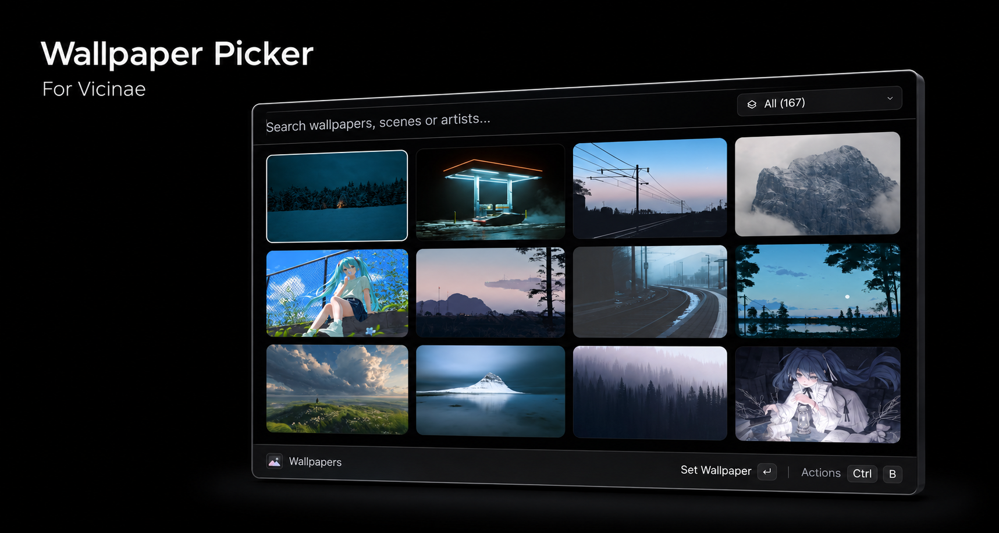

# Vicinae Wallpaper Picker



Browse and switch wallpapers from [Vicinae](https://vicinae.com): a thumbnail
grid for still images and live wallpapers, with favourites, collections, colour
filters and animated transitions through [awww](https://codeberg.org/LGFae/awww).
Before applying, you can pick one of the image's [matugen](https://github.com/InioX/matugen)
palettes or an accent, previewed with the colours your theme will get.

The picker only sets wallpapers. Theming runs in an optional hook you control;
the [matugen example](examples/matugen/README.md) shows one setup.

[Install](#install) · [Features](#features) · [Keys](#keys) · [Colours](#choosing-colours) · [Hooks](#local-settings-and-hooks) · [Live wallpapers](#live-wallpapers) · [Troubleshooting](#troubleshooting)

## Install

Requires Linux, Vicinae and a Wayland compositor supported by awww, such as
Hyprland or Sway. This backend does not support X11, GNOME, KDE, macOS or Windows.

```sh
git clone https://github.com/s3rven/vicinae-wallpaper-picker
cd vicinae-wallpaper-picker
./install.sh
```

The installer checks dependencies, runs `npm ci` from the lockfile, and builds
into Vicinae's extension directory. It does not need sudo or edit your desktop
configuration.

1. Open **Set Wallpaper** in Vicinae.
2. Choose your wallpaper folder in the extension preferences. The default is
   `~/Pictures/wallpaper`; create it or select an existing folder.
3. Search or choose a collection, select an image, and press **Enter**.

Other installer options:

```sh
./install.sh --check                       # dependency check only
./install.sh --build-only                  # build to release/extension
./install.sh --output /path/to/extension   # build to a chosen directory
```

`--build-only` and `--output` can build on a headless Linux machine with
Node.js/npm. Installs and `--check` also check the desktop tools below.
`--check` cannot be combined with build/output options.

| Dependency | Purpose |
|---|---|
| Vicinae | Launcher and extension runtime |
| Node.js 22+ and npm | Build the extension |
| awww and awww-daemon | Set wallpapers and animate transitions |
| Bash 4.4+, coreutils, findutils, `flock` from util-linux | Backend scripts |
| ImageMagick (`magick` or `convert`), recommended | Small thumbnails and colour filters; stills work without it |
| matugen and jq, optional | Palette previews in the colour step |
| Python 3, optional for stills | Faster scans and Hyprland monitor routing |
| mpvpaper, ffmpeg, Python 3 and a systemd user session, optional | Live wallpapers |
| ffprobe, optional | Prepare downloaded videos with `import-live.sh` |
| notify-send, optional | Desktop error notifications |

The scripts are bundled with the extension; the source clone can live anywhere
or be removed after installation. The installer downloads npm dependencies.
The running picker makes no network requests; source links open only when you
choose **Open Source Page**.

### Update

From your source checkout:

```sh
git pull --ff-only
./install.sh
```

The installer rebuilds the extension from the lockfile. Your wallpaper library,
favourites and local settings are kept outside the checkout.

## Features

- **Pictures first.** The grid shows thumbnails only and opens on your current
  wallpaper, with favourites after it. The footer names the selected one;
  names also live in tooltips and search.
- **Collections and filters.** Subfolders become collections, and Archive/Old
  folders get their own filter. Filter by colour (**Ctrl+Shift+F**), favourites,
  live or still, and combine a colour with a collection. The picker
  remembers your filter and sort.
- **Search** matches names, titles, tags, folders and colour names.
  Abbreviations such as `lndscp` work when nothing matches literally.
- **Sort** by colour, date or name. Names sort naturally (Night 2 before Night 10).
- **Colour step.** Choose a palette from the image or a pinned accent before
  applying; see [Choosing colours](#choosing-colours).
- **Transitions:** fade, spotlight, iris, wave, wipes and random, straight
  through awww. Change the effect and duration from the action panel.
- **Random and Previous.** **Ctrl+Shift+R** sets a random still from the current
  view; **Random Wallpaper** on a keybind shuffles the whole library. **Previous
  Wallpaper** swaps between the last two choices.
- **Solid colours** from presets or a `#RGB` / `#RRGGBB` value. They work with
  Previous, transitions and login restore like any image.
- **Live wallpapers** through mpvpaper, paused automatically behind windows on
  Hyprland.
- **Fast on large libraries.** Thumbnails and colours are cached and filled in
  the background, so a new library opens immediately. Damaged files time out
  instead of holding up the rest.
- **Safe applies.** Applies and login restore share a lock. A failed apply puts
  the previous image back, and rapid choices apply only the newest one.

## Keys

| Key | Action |
|---|---|
| Enter | Choose colours, then apply |
| Shift+Enter | Set immediately (or open colours when immediate apply is the default) |
| Ctrl+Shift+R | Random still from the current search/filter |
| Ctrl+F | Add/remove favourite |
| Ctrl+Shift+F | Filter by colour, within the current collection |
| Ctrl+S | Choose sort order |
| Ctrl+Shift+B | Switch search/browse mode |
| Ctrl+Shift+P | Pause/resume live wallpaper |
| Ctrl+O | Open full size |
| Ctrl+R | Rescan |
| Ctrl+Shift+C | Copy path |

You can also bind the no-window commands in your compositor. Hyprland example:

```ini
bind = SUPER SHIFT, W, exec, vicinae cmd launch @s3rven/wallpaper-picker:set-wallpaper
bind = SUPER ALT, W, exec, vicinae cmd launch @s3rven/wallpaper-picker:random-wallpaper
bind = SUPER ALT SHIFT, W, exec, vicinae cmd launch @s3rven/wallpaper-picker:previous-wallpaper
```

## Restore at login

The picker remembers the original path, fit and crop anchor. Add the bundled
restore script to your compositor's autostart. For the default data directory,
a Hyprland example is:

```ini
exec-once = ~/.local/share/vicinae/extensions/wallpaper-picker/assets/backend/restore-wallpaper.sh
```

For Sway, use `exec` with that script path. If you set `XDG_DATA_HOME`, use its
`vicinae/extensions/wallpaper-picker/assets/backend/restore-wallpaper.sh` path.
It starts awww-daemon when needed. Restoring does not run post-apply hooks.

## Choosing colours

**Enter** on a wallpaper opens its colours, with the wallpaper beside the list.

- **From This Wallpaper:** up to four matugen palettes of the image. Each shows
  the accent, complement and surface your theme will get. A palette belongs to
  its wallpaper: Previous, Random and a direct apply bring that wallpaper back
  with the palette you last chose for it, listed first as **Last Used**.
- **Accents:** twelve muted presets. An accent stays pinned for later wallpapers
  until you choose a palette again.
- **Custom:** type a `#RGB` or `#RRGGBB` hex in the search bar.

Previews read the thumbnail cache and never generate a theme. They need matugen
and jq; without them the list offers **Automatic** and the accents. **Ctrl+R**
reloads the palettes. To skip this step, set **Wallpaper click action** to
immediate apply in preferences; **Shift+Enter** always offers the other action.

The colour filter (**Ctrl+Shift+F**) needs ImageMagick. A chosen colour stays
selected even with no matches; **All Colours** or **Clear Colour Filter** resets
it. **Copy Wallpaper Colour** copies an image's dominant hex.

## Transitions

Open the action panel and choose **Transition** to pick an effect or duration.
**Use Extension Defaults** returns both to the extension preferences, and
**None** changes images immediately.

Fade is the default, at 0.28 seconds. Wipes take about 0.32 seconds, wave 0.38
and circular reveals 0.4. Frame pacing follows your display's refresh rate.
**Auto** uses each effect's tuned duration.

## Local settings and hooks

Optional settings belong in
`${XDG_CONFIG_HOME:-$HOME/.config}/wallpaper-picker/env`.
Copy [examples/env.example](examples/env.example) as a starting point. This is
trusted shell code; keep your real settings outside the public repository.

| Variable | Effect |
|---|---|
| `AWWW_BLACKOUT_MATCH` | Optional case-insensitive regex matching Hyprland monitor names/descriptions. Those outputs get a solid colour. |
| `AWWW_BLACKOUT_COLOR` | Solid fill for matched outputs, default `0x000000`. |
| `WALLPAPER_PICKER_POST_APPLY` | Optional executable called with the original wallpaper path after a successful apply. Limited to ten seconds. |
| `WALLPAPER_LIVE_MPV_OPTIONS` | mpv options, default `no-audio loop hwdec=auto-safe panscan=1.0`. |
| `WALLPAPER_LIVE_EGL_VENDOR` | Optional glvnd vendor JSON for hybrid-GPU setups. |
| `WALLPAPER_LIVE_FPS`, `_MIN_LOOP`, `_SIZE`, `_DIR` | Frame-rate cap, minimum clip length, output size and destination for `import-live.sh`. |
| `WALLPAPER_TRANSITION_FPS`, `_ANGLE`, `_POS`, `_BEZIER`, `_WAVE`, `WALLPAPER_SCALING_FILTER` | Low-level awww options. |

A post-apply hook can run matugen or another tool. The picker does not generate
application themes, edit app configs or reload desktop applications. See the
[separate matugen setup example](examples/matugen/README.md). Hook failures
report an error while keeping the successfully set wallpaper.

A hook receives:

| Value | Meaning |
|---|---|
| `$1` | The original wallpaper path. |
| `WALLPAPER_PICKER_CURRENT_IMAGE` | A still image: the wallpaper itself, or a video's first frame. |
| `WALLPAPER_PICKER_THUMBNAIL` | The cached thumbnail the colour previews were made from, when one exists. Theme from it so the result matches the preview. |
| `WALLPAPER_PICKER_PALETTE_INDEX` | The chosen palette, or the one last chosen for this wallpaper, as matugen's `--source-color-index` (0-3). |
| `WALLPAPER_PICKER_ACCENT` | The pinned `#RRGGBB` accent, or empty when a palette is used. |
| `WALLPAPER_PICKER_ACCENT_CHANGED` | `1` after an explicit colour choice; `0` for immediate, random and previous applies, which keep the saved choice. |

## Live wallpapers

`.mp4`, `.webm` and `.mkv` files play through mpvpaper above a still of their
first frame. The same still is used for previews and the optional hook.
Missing live dependencies are reported when applying a video; stills do not
require them. Window-based automatic pause needs Hyprland; manual pause works
on other supported compositors too.

Prepare large downloads once, if desired:

```sh
./import-live.sh ~/Downloads/*.mp4
```

This imports into `<wallpaper folder>/Live`, caps the frame rate at 30 fps,
removes audio and repeats short clips to reduce loop hitches. Set
`WALLPAPER_LIVE_DIR` when your extension preference uses a different library.
Without a detected Hyprland output size, the target is 1920x1080; smaller
sources are not upscaled. Preparation requires ffmpeg, ffprobe and Python 3.
If one clip fails, the rest of the batch continues; the command exits with a
nonzero status to report any skipped or failed inputs. Existing files are kept.

For a keybind, use **Pause or Resume Live Wallpaper**, or call the bundled
`live-wallpaper.py` with `pause`, `resume`, `toggle`, or `status`. Manual pause
persists across logins. The `idle` and `active` commands are suitable for
hypridle hooks, to stop decoding while the screen is locked or asleep.

## Library metadata

Supported still formats: JPEG, PNG and WebP. Subfolders are scanned to the depth
chosen in preferences. Folder paths can contain spaces and Unicode. Filenames
containing tabs/newlines are skipped because the scanner uses a record format.
Thumbnail rendering treats names containing `*`, `?` or brackets as literal paths.

An optional `.wallpaper-library.json` in the wallpaper folder adds searchable
titles, tags, source links and resolution labels. Keys are relative paths:

```json
{
  "version": 1,
  "wallpapers": {
    "Scenes/rain.jpg": {
      "title": "Rainy neon alley",
      "tags": ["city", "rain"],
      "source": "https://wallhaven.cc/w/abc123",
      "resolution": "3840x2160"
    }
  }
}
```

Wallhaven filenames get source links automatically. Filenames remain searchable
and appear in tooltips, leaving the grid mostly pictures.

## Local data

Configuration, state, cache and runtime paths respect the corresponding XDG
variables. Defaults:

- State: `~/.local/state/wallpaper-picker/`, including `current`, `current-image`
  (a still-image symlink), `previous`, `fit`, `favourites` and `last-apply.log`.
- Cache: `~/.cache/wallpaper-picker/`.
- Live sockets/flags: `$XDG_RUNTIME_DIR/wallpaper-picker/runtime`, or a private
  directory under the picker cache when no runtime directory is available.

State and caches can contain absolute paths to your own files. They stay outside
the source repository. The source exporter excludes them and Git history; see
[RELEASING.md](RELEASING.md) before making the project public.

## Troubleshooting

| Problem | What to check |
|---|---|
| Empty library or folder error | Open extension preferences and select a readable folder containing JPEG, PNG, WebP or supported videos. Check the subfolder depth. |
| Wallpaper does not change | Run `./install.sh --check`, then `awww query` in your Wayland session. The daemon must be reachable from the session running Vicinae. |
| A failed apply closes the picker | Read `~/.local/state/wallpaper-picker/last-apply.log` (or its `XDG_STATE_HOME` equivalent) for the backend error. Desktop notifications need `notify-send`. |
| Colours or small thumbnails are missing | Install ImageMagick and press Ctrl+R. The first scan fills the thumbnail/colour cache in the background. |
| Live wallpaper shows only a still | Check the optional live dependencies and a working systemd user session. Inspect `journalctl --user -u wallpaper-live.service -b --no-pager` for player errors. |
| Wallpaper changes but app colours do not | Theming is opt-in. Follow the [matugen example](examples/matugen/README.md) or configure your own post-apply hook. |
| App colours differ from the colour preview | Theme from `WALLPAPER_PICKER_THUMBNAIL` with `--resize-filter nearest`, as the example hook does. Matugen finds different colours in a full-size image. |

## Development

```sh
cd vicinae
npm ci
npm run dev
npm test
npm run lint
npx tsc --noEmit
shellcheck -x -P .. ../*.sh ../examples/matugen/post-apply.sh
```

Tests use fake desktop commands, temporary state and simulated compositor
sockets. They do not change your real wallpaper or desktop configuration.

## License

MIT
